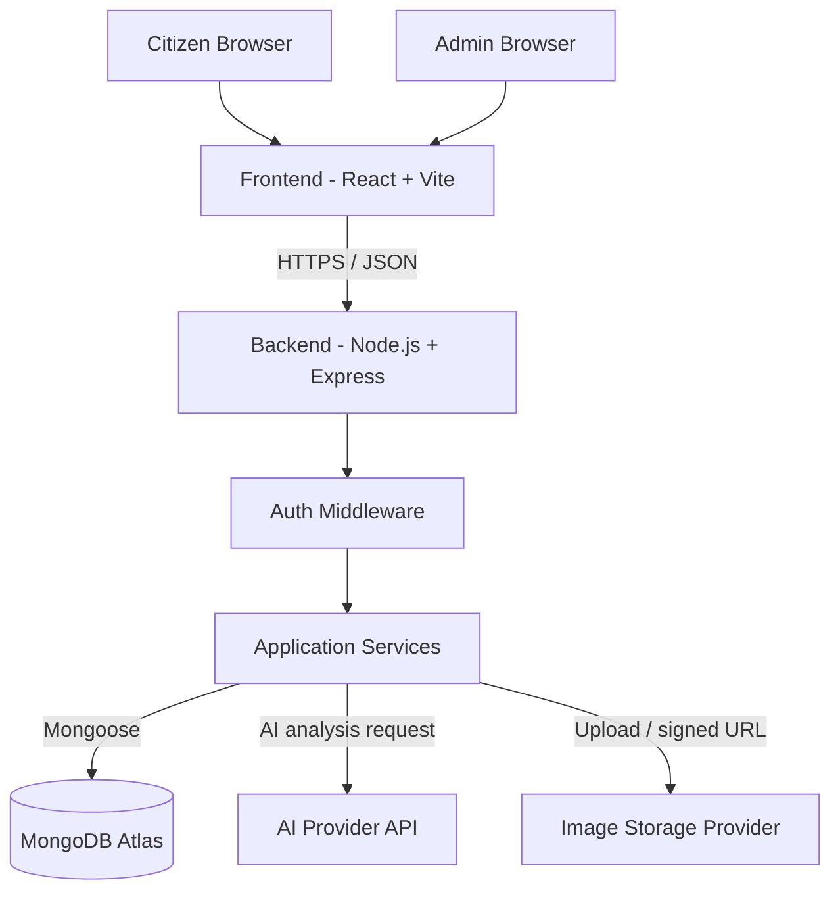

# CivicAI — System Architecture

**Version:** 1.0  
**Architecture style:** React SPA + Express REST API + MongoDB Atlas

## 1. High-level architecture



## 2. Repository structure

```text
civicai/
├── frontend/
│   ├── public/
│   │   ├── images/
│   │   └── videos/
│   ├── src/
│   │   ├── assets/
│   │   ├── components/
│   │   │   ├── common/
│   │   │   ├── layout/
│   │   │   ├── forms/
│   │   │   └── reports/
│   │   ├── features/
│   │   │   ├── auth/
│   │   │   ├── citizen/
│   │   │   ├── reports/
│   │   │   └── admin/
│   │   ├── pages/
│   │   ├── routes/
│   │   ├── services/
│   │   ├── hooks/
│   │   ├── context/
│   │   ├── utils/
│   │   ├── styles/
│   │   ├── App.jsx
│   │   └── main.jsx
│   ├── .env.example
│   ├── package.json
│   └── vite.config.js
│
├── backend/
│   ├── src/
│   │   ├── config/
│   │   ├── controllers/
│   │   ├── middleware/
│   │   ├── models/
│   │   ├── routes/
│   │   ├── services/
│   │   │   ├── ai/
│   │   │   └── storage/
│   │   ├── validators/
│   │   ├── utils/
│   │   ├── constants/
│   │   └── app.js
│   ├── server.js
│   ├── .env.example
│   └── package.json
│
├── docs/
│   ├── prd.md
│   ├── architecture.md
│   ├── rules.md
│   ├── design.md
│   ├── task.md
│   └── memory.md
├── .gitignore
└── README.md
```

## 3. Folder responsibilities

### `frontend/`
Owns presentation and browser-side interaction only.
- React components and pages.
- Client-side form validation for usability.
- Route guards for user experience (not the security boundary).
- API calls to the backend.
- Loading, error, empty, and success states.
- Theme tokens and visual assets.
- Never contains MongoDB credentials, AI provider secrets, or privileged business logic.

### `backend/`
Owns security, business rules, persistence, and integrations.
- Express REST API.
- Authentication and role authorization.
- Server-side validation.
- Mongoose models and database access.
- AI provider calls and output validation.
- Image upload integration.
- Status transition rules and audit history.
- Central error handling and logging.

### MongoDB Atlas
Owns persistent application data.
- `users` collection.
- `complaints` collection.
- Optional `notifications` collection in a later phase.
- Optional `auditLogs` collection if audit volume or reporting needs justify separation.

## 4. Backend request flow

1. Browser sends an HTTPS request to the Express API.
2. Express route validates request shape.
3. Authentication middleware verifies the JWT when the route is protected.
4. Authorization middleware checks role and resource ownership.
5. Controller calls a service.
6. Service applies business rules and reads/writes MongoDB through Mongoose.
7. For AI analysis, service calls the configured provider, validates the response, and stores the result.
8. API returns a consistent JSON response.

## 5. API conventions

Base path: `/api/v1`

Recommended endpoints:

| Method | Endpoint | Access | Purpose |
|---|---|---|---|
| POST | `/auth/register` | Public | Create citizen account |
| POST | `/auth/login` | Public | Authenticate |
| POST | `/auth/logout` | Authenticated | Clear session |
| GET | `/auth/me` | Authenticated | Current user |
| POST | `/complaints` | Citizen | Create report |
| GET | `/complaints/mine` | Citizen | List own reports |
| GET | `/complaints` | Admin | List/filter all reports |
| GET | `/complaints/:id` | Owner or admin | Report detail |
| PATCH | `/complaints/:id/status` | Admin | Change status |
| PATCH | `/complaints/:id/triage` | Admin | Correct category/priority/department |
| POST | `/complaints/:id/notes` | Admin | Add admin note |
| GET | `/dashboard/citizen` | Citizen | Citizen metrics |
| GET | `/dashboard/admin` | Admin | Admin metrics |
| GET | `/health` | Public | Service health |

Use pagination parameters such as `page` and `limit`; cap the maximum page size.

Consistent success response:

```json
{
  "success": true,
  "data": {},
  "message": "Request completed"
}
```

Consistent error response:

```json
{
  "success": false,
  "error": {
    "code": "VALIDATION_ERROR",
    "message": "Please check the submitted fields"
  }
}
```

## 6. MongoDB data model

### User

```js
{
  _id: ObjectId,
  name: String,
  email: { type: String, unique: true, lowercase: true },
  passwordHash: String,
  role: { type: String, enum: ["CITIZEN", "ADMIN"], default: "CITIZEN" },
  createdAt: Date,
  updatedAt: Date
}
```

Never store plaintext passwords. Public registration must always create a `CITIZEN`; provision admin accounts through a controlled seed or secure administrative process.

### Complaint

```js
{
  _id: ObjectId,
  referenceCode: String,
  citizenId: { type: ObjectId, ref: "User", index: true },
  title: String,
  description: String,
  location: {
    address: String,
    latitude: Number,
    longitude: Number
  },
  category: String,
  priority: { type: String, enum: ["LOW", "MEDIUM", "HIGH"] },
  department: String,
  status: {
    type: String,
    enum: ["SUBMITTED", "UNDER_REVIEW", "ASSIGNED", "IN_PROGRESS", "RESOLVED", "REJECTED"]
  },
  image: {
    url: String,
    storageKey: String,
    mimeType: String
  },
  aiAnalysis: {
    status: { type: String, enum: ["PENDING", "COMPLETED", "FAILED"] },
    summary: String,
    suggestedCategory: String,
    suggestedPriority: String,
    suggestedDepartment: String,
    rationale: String,
    analyzedAt: Date
  },
  assignedTo: { type: ObjectId, ref: "User", default: null },
  statusHistory: [{
    from: String,
    to: String,
    changedBy: { type: ObjectId, ref: "User" },
    note: String,
    changedAt: Date
  }],
  adminNotes: [{
    authorId: { type: ObjectId, ref: "User" },
    text: String,
    createdAt: Date
  }],
  createdAt: Date,
  updatedAt: Date
}
```

Do not expose internal admin notes in citizen API responses.

## 7. AI integration boundary

- Implement an `aiAnalysisService` behind a provider-neutral interface.
- Read the provider API key only from backend environment variables.
- Send only the minimum complaint text needed for classification.
- Ask for strict JSON with allowed category, priority, and department values.
- Parse and validate output on the server.
- Set an explicit timeout and handle provider errors.
- Save the complaint before or independently of AI analysis so provider failure never loses a report.
- Do not allow AI to set final status or assign staff automatically.

## 8. Image storage

Use an external object/image storage service for uploaded files.
- Validate MIME type and size on the backend.
- Use randomized storage keys.
- Store only URL, storage key, and metadata in MongoDB.
- Do not trust a file extension as proof of file type.
- Never expose storage secrets in frontend environment variables.

## 9. Security boundaries

- HTTPS in deployed environments.
- bcrypt password hashing.
- JWT in HttpOnly, Secure, SameSite cookies where practical.
- CORS allowlist for the frontend origin.
- Rate-limit login and public submission endpoints.
- Validate and sanitize all incoming data.
- Enforce ownership and role checks on every protected resource.
- Keep `.env` files out of version control.
- Avoid logging credentials, tokens, or full sensitive payloads.

## 10. Deployment topology (later phase)

- Frontend: static React build on a frontend hosting provider.
- Backend: Node.js service on a backend hosting provider.
- Database: MongoDB Atlas.
- Media: external image storage.
- AI: server-to-server provider API.

Deployment is intentionally outside the first build phase unless requested.
